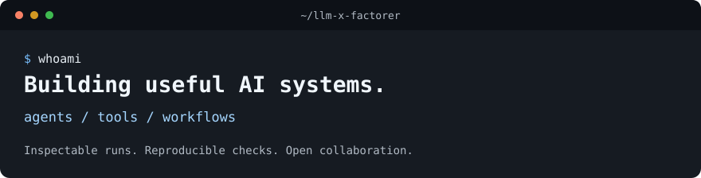

  

**I build AI agents, practical tools, and the systems around them.**

我把真实工作中的复杂流程，做成 AI 产品、可复用工具和可验证的工程实践。

My work spans desktop agents, document and data workflows, and software for day-to-day operations. I work with [Tenisinfinite Tech](https://www.tenisinfinite.com/) and share public tools, reference implementations, and engineering experiments here.

## Engineering interests / 我关注的工程问题

- **Agent runtimes & tools** — explicit permissions, inspectable runs, and recovery when a task fails. 让工具调用有边界，执行过程能检查，失败后能恢复。
- **Document & data workflows** — traceable sources, structured outputs, and checks on the artifacts people actually use. 从原始材料到交付物，保留来源和验证步骤。
- **Software for real operations** — connecting business rules, integrations, and human decisions. 把业务规则、系统对接和人工确认落实到工作流程中。

TypeScript / Node.js · Python · React / Electron · FastAPI · SQL · Docker

## Public projects / 公开项目

These are entry points into my engineering work. Project status and setup requirements live in each repository.

### [LocalBuddy V2](https://github.com/LLM-X-Factorer/diantou-localbuddy-v2) · Engineering alpha

A local-first multi-agent desktop runtime with explicit permissions, isolated coding worktrees, and resumable runs. Uses remote LLM providers.

桌面 Agent 运行时：关注权限、任务恢复与编码工作区隔离。适合一起复现真实任务，改进恢复行为和跨平台体验。

### [DeepFlow Analyst](https://github.com/LLM-X-Factorer/deepflow-analyst) · Teaching reference

Natural-language SQL analysis with multi-agent review, human clarification, and execution-based evaluation.

数据分析 Agent 的教学参考实现：从自然语言生成 SQL，通过实际执行核对结果。欢迎补充独立评测案例和失败查询。

### [topic2md](https://github.com/LLM-X-Factorer/topic2md) · Pluggable workflow

A topic-to-Markdown pipeline with research, citations, images, and pluggable research and publishing integrations.

从选题到带来源的文章，把研究、写作、配图和发布接成可扩展流程。可从[中文研究源插件讨论 #14](https://github.com/LLM-X-Factorer/topic2md/issues/14)参与。

### [Meeting Recap Skill](https://github.com/LLM-X-Factorer/diantou-meeting-recap-skill) · Workflow example

A DeepSeek Harness example that turns sanitized transcripts into reviewable Markdown, PDF, and Feishu card drafts, with contract tests.

会议材料到可审阅交付物的 Skill / Tool / Hook 示例。欢迎补充脱敏样例、转录适配器和输出一致性检查。

### [Markdown → Slides & Video](https://github.com/LLM-X-Factorer/diantou-md-to-remotion-video-skill) · Workflow example

A DeepSeek Harness workflow for editable PPTX and Remotion video, timed to generated audio and checked at the artifact level.

把 Markdown 做成可编辑幻灯片与配音视频。欢迎改进中文排版、TTS 适配器、场景模板和渲染兼容性。

More tools & research / 更多工具与研究

- [md2red](https://github.com/LLM-X-Factorer/md2red) — Markdown to image-text cards, with preview and export for manual publishing.
- [md2wechat](https://github.com/LLM-X-Factorer/md2wechat) — a fork of [sawyerbutton/md2wechat](https://github.com/sawyerbutton/md2wechat), connecting Markdown to the WeChat draft box.
- [podcraft](https://github.com/LLM-X-Factorer/podcraft) — Markdown to a two-person dialogue podcast.
- [cn-seo-geo-atlas](https://github.com/LLM-X-Factorer/cn-seo-geo-atlas) — research notes and experiment designs on Chinese search and AI citations.
- [awesome-geo-cn](https://github.com/LLM-X-Factorer/awesome-geo-cn) — a curated index of Chinese GEO resources.

## Build together / 一起做点东西

I welcome reproducible bug reports, independent evaluation cases, focused adapters, and improvements to developer documentation.

可以从一个小而具体的问题开始：

- **Agent reliability** — reproduce a failed run, improve recovery, or add a permission-boundary test. Start with [LocalBuddy Issues](https://github.com/LLM-X-Factorer/diantou-localbuddy-v2/issues).
- **Evaluation & integrations** — add a SQL evaluation case or explore a research-source plugin. See [DeepFlow Issues](https://github.com/LLM-X-Factorer/deepflow-analyst/issues) and [topic2md's contributing guide](https://github.com/LLM-X-Factorer/topic2md/blob/main/CONTRIBUTING.md).
- **Artifacts & developer experience** — improve a layout, renderer, adapter, or reproducible example in either workflow Skill above.

For a larger change, open an issue in the relevant repository with the problem, expected behavior, and a minimal example. 中文 / English 都欢迎。

## Elsewhere / 其他地方

[Tenisinfinite Tech](https://www.tenisinfinite.com/) · [SEO / GEO course](https://factorer.app/) · [X / @JadeGateAI](https://x.com/JadeGateAI) · [知乎](https://www.zhihu.com/people/dt-35-81) · [B 站](https://space.bilibili.com/3546970262079983)

Other profiles / 其他账号

[小红书](https://www.xiaohongshu.com/user/profile/67cfd1270000000008017fe3) · [即刻](https://web.okjike.com/u/630DA54B-3708-43B1-A900-7D266794AA4C)

