<a href="assets/hero-light.svg#gh-light-mode-only"><picture>
  <source media="(max-width: 600px) and (prefers-reduced-motion: reduce)" srcset="assets/hero-light-mobile-still.svg">
  <source media="(max-width: 600px)" srcset="assets/hero-light-mobile.svg">
  <source media="(prefers-reduced-motion: reduce)" srcset="assets/hero-light-still.svg">
  
</picture></a><a href="assets/hero-dark.svg#gh-dark-mode-only"><picture>
  <source media="(max-width: 600px) and (prefers-reduced-motion: reduce)" srcset="assets/hero-dark-mobile-still.svg">
  <source media="(max-width: 600px)" srcset="assets/hero-dark-mobile.svg">
  <source media="(prefers-reduced-motion: reduce)" srcset="assets/hero-dark-still.svg">
  
</picture></a>

**I build AI agents, document workflows, and practical tools.**

把复杂工作做成有用的 AI 工具，和同行一起把细节打磨好。

  
  
  

##  Agent bay

*运行时与评测工作台 · Permissions, recoverable tasks, and checks on actual outputs.*

- **[LocalBuddy V2](https://github.com/LLM-X-Factorer/diantou-localbuddy-v2)** · **Engineering alpha** — a local-first multi-agent desktop runtime with explicit permissions, isolated coding worktrees, and resumable runs. Uses remote LLM providers.
- **[DeepFlow Analyst](https://github.com/LLM-X-Factorer/deepflow-analyst)** · **Teaching reference** — natural-language SQL analysis with multi-agent review, human clarification, and execution-based evaluation.

##  Workflow shelf

*从材料到交付物 · Research, write, render, and check.*

- **[topic2md](https://github.com/LLM-X-Factorer/topic2md)** — a pluggable topic-to-Markdown pipeline for research, citations, images, and publishing integrations.
- **[Meeting Recap Skill](https://github.com/LLM-X-Factorer/diantou-meeting-recap-skill)** · **Workflow example** — sanitized transcripts to reviewable Markdown, PDF, and Feishu card drafts, with DeepSeek Harness tools and contract tests.
- **[Markdown → Slides & Video](https://github.com/LLM-X-Factorer/diantou-md-to-remotion-video-skill)** · **Workflow example** — editable PPTX and audio-timed Remotion video, with checks on the generated artifacts.

##  Quest board

*从一个小问题开始 · Pick a small problem to work on together.*

1. **[Reproduce a tricky agent run](https://github.com/LLM-X-Factorer/diantou-localbuddy-v2/issues)** — bring a minimal example, expected behavior, and a sanitized trace. Help improve recovery and permission boundaries.
2. **[Add an independent SQL evaluation case](https://github.com/LLM-X-Factorer/deepflow-analyst/issues)** — contribute a question, sample data, and the expected result; investigate a query that fails.
3. **[Explore Chinese research sources · topic2md #14](https://github.com/LLM-X-Factorer/topic2md/issues/14)** — compare sources and propose a stable integration. Start with the [plugin contribution guide](https://github.com/LLM-X-Factorer/topic2md/blob/main/CONTRIBUTING.md).

Bug reports, focused adapters, better examples, and clearer documentation are welcome. For a larger change, open an issue to discuss the scope first. 中文 / English 都欢迎。

🧰 Open the toolbox / 技术工具箱

TypeScript / Node.js · Python · React / Electron · FastAPI · SQL · Docker

I care about inspectable runs, traceable sources, human review, and useful outputs. My work also includes software that connects business rules and day-to-day operations.

📦 Open the spare-parts drawer / 更多工具与研究

- [md2red](https://github.com/LLM-X-Factorer/md2red) — Markdown to image-text cards, with preview and export for manual publishing.
- [md2wechat](https://github.com/LLM-X-Factorer/md2wechat) — a fork of [sawyerbutton/md2wechat](https://github.com/sawyerbutton/md2wechat), connecting Markdown to the WeChat draft box.
- [podcraft](https://github.com/LLM-X-Factorer/podcraft) — Markdown to a two-person dialogue podcast.
- [cn-seo-geo-atlas](https://github.com/LLM-X-Factorer/cn-seo-geo-atlas) — research notes and experiment designs on Chinese search and AI citations.
- [awesome-geo-cn](https://github.com/LLM-X-Factorer/awesome-geo-cn) — a curated index of Chinese GEO resources.

📬 Find me elsewhere / 工坊之外

I work with [Tenisinfinite Tech](https://www.tenisinfinite.com/).

[SEO / GEO course](https://factorer.app/) · [X / @JadeGateAI](https://x.com/JadeGateAI) · [知乎](https://www.zhihu.com/people/dt-35-81) · [B 站](https://space.bilibili.com/3546970262079983) · [小红书](https://www.xiaohongshu.com/user/profile/67cfd1270000000008017fe3) · [即刻](https://web.okjike.com/u/630DA54B-3708-43B1-A900-7D266794AA4C)

